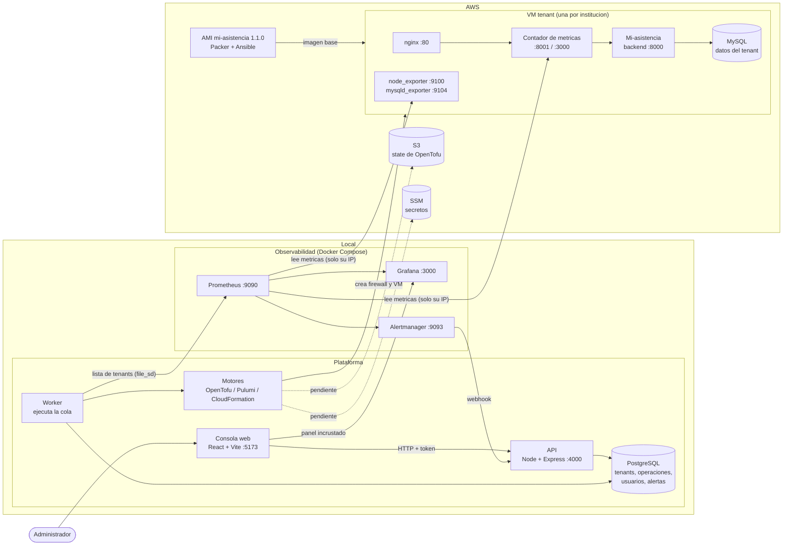
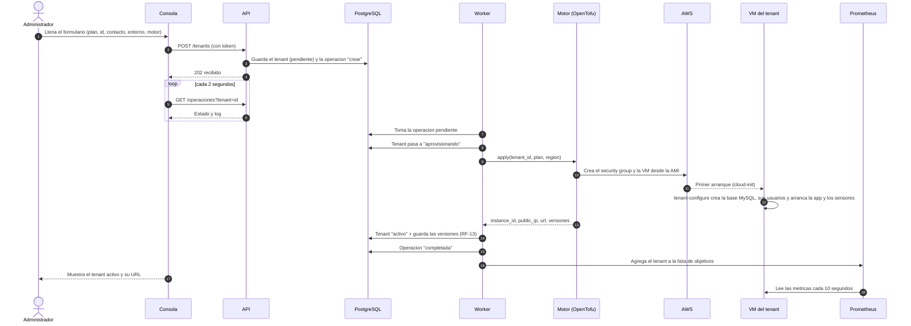
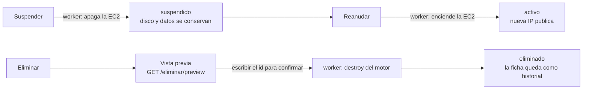

# Arquitectura de la plataforma

La plataforma crea y administra una VM en AWS por cada institucion (tenant). Cada VM tiene su propia app de asistencia (Mi-asistencia) y su propia base MySQL, asi ningun tenant comparte datos con otro.

La plataforma (consola, API, worker y su base PostgreSQL) y la observabilidad (Prometheus, Grafana y Alertmanager) corren en local. Los tenants corren en AWS.

> En los diagramas, las lineas punteadas marcan lo que **aun esta pendiente** (ver la tabla al final).

## 1. Piezas y donde corre cada una

## 2. Que hace cada pieza

| Pieza | Que hace | Carpeta | Integrante |
|---|---|---|---|
| Consola web | Pantallas para el administrador: login, tenants, crear, detalle, planes y monitoreo (con Grafana incrustado) | `web/` | 2 |
| API | Recibe los pedidos, valida la sesion y los permisos, anota cada trabajo en la cola y recibe las alertas | `api/api.js`, `api/auth.js` | 1 |
| PostgreSQL | Base de la plataforma: planes, tenants, operaciones, despliegues, usuarios y alertas | `db/schema.sql` | 1 |
| Worker | Toma los trabajos pendientes, los ejecuta con el motor del tenant y actualiza la lista de tenants de Prometheus | `api/worker.js`, `api/sync-targets.js` | 1 |
| Motores | Crean y destruyen la infraestructura de un tenant. Todos cumplen el mismo contrato | `api/motor-*.js`, `contrato/` | 1 |
| Plantillas de infraestructura | Firewall y VM del tenant en OpenTofu, Pulumi y CloudFormation | `infra/` | 4 |
| AMI del tenant | Imagen con nginx, Node, MySQL, la app y los sensores de metricas ya instalados | `packer/`, `ansible/` | 3 |
| Observabilidad | Prometheus, Grafana (tablero por tenant) y Alertmanager | `observabilidad/` | 5 |
| Seguridad y CI | 3 escaneres y pruebas de aislamiento en cada Pull Request | `.github/`, `tests/`, `security/` | 6 |

**Roles:** `admin_plataforma` ve y administra todos los tenants. `admin_tenant` solo ve y opera su propia institucion.

**Docker:** las VM de los tenants no usan Docker (Packer + Ansible). La observabilidad si usa Docker Compose para levantar Prometheus, Grafana y Alertmanager juntos, reutilizando la configuracion ya probada.

**Por que la observabilidad corre en local:** la plataforma corre en local y AWS no puede iniciar conexiones hacia ella. Con Prometheus en local, lee la lista de tenants que escribe el worker y Alertmanager entrega las alertas a la API sin exponer la PC a internet. Para moverla a AWS haria falta un rol de IAM que permita a Prometheus descubrir las VM, y que la API consulte las alertas a Alertmanager.

**Metricas de cada tenant:** `node_exporter` (9100), `mysqld_exporter` (9104, con un usuario de MySQL que solo lee estadisticas) y un contador de la app (3000, entre nginx y el backend). El firewall solo abre esos puertos a la IP de Prometheus (`MONITORING_CIDR`).

## 3. Flujo: crear un tenant

Si un paso falla, la operacion queda `fallida` con su error y se puede **reintentar** (RF-12). OpenTofu guarda un state por tenant, asi el reintento no duplica recursos.

## 4. Flujo: suspender, reanudar y eliminar

## 5. Pruebas en AWS (14/11/2026)

Todas las pruebas se hicieron desde la consola, con `ENGINE=tofu`, y cada tenant se elimino al terminar. Despues de cada prueba se verifico que no quedaran VM, discos, firewalls ni IP elasticas de la prueba.

| Prueba | Tenant | Imagen | Resultado | Requisitos |
|---|---|---|---|---|
| 1. Crear infraestructura | `prueba-aws` (basico) | Ubuntu sin AMI propia | VM y firewall creados; la IP mostro la pagina de prueba; suspender y eliminar funcionaron | RF-09, RF-16, RF-18 |
| 2. App real | `app-prueba` (basico) | `mi-asistencia-1.0.0` | Login de administrador en Mi-asistencia con su propia base MySQL; disco cifrado, IMDSv2 y solo el puerto 80 abierto; versiones registradas | RF-10, RF-13, RF-21 |
| 3. Metricas reales | `colegio-grafana` (estandar) | `mi-asistencia-1.1.0` | Grafana mostro disponibilidad, MySQL y servidor en verde, y peticiones y latencia reales; los puertos de metricas solo abiertos a la IP de Prometheus; suspender y reanudar funcionaron | RF-25, RF-26, RF-27 |

## 6. Pendientes

| Pendiente | Que falta | Integrantes |
|---|---|---|
| Prueba de una alerta real | Provocar una alerta (por ejemplo, cortar el sensor de la app 2 minutos) y verla en la consola | 5 |
| State en S3 | Hoy esta en `api/workdir/<tenant_id>`. Moverlo a un bucket S3 cifrado y con bloqueo | 1 y 4 |
| Secretos en SSM | La clave inicial del admin del tenant viaja en `user_data` | 1 y 4 |
| Observabilidad en AWS (opcional) | Requiere un rol de IAM para que Prometheus descubra las VM; el usuario actual no tiene permisos de IAM | Dueño de la cuenta y 5 |
