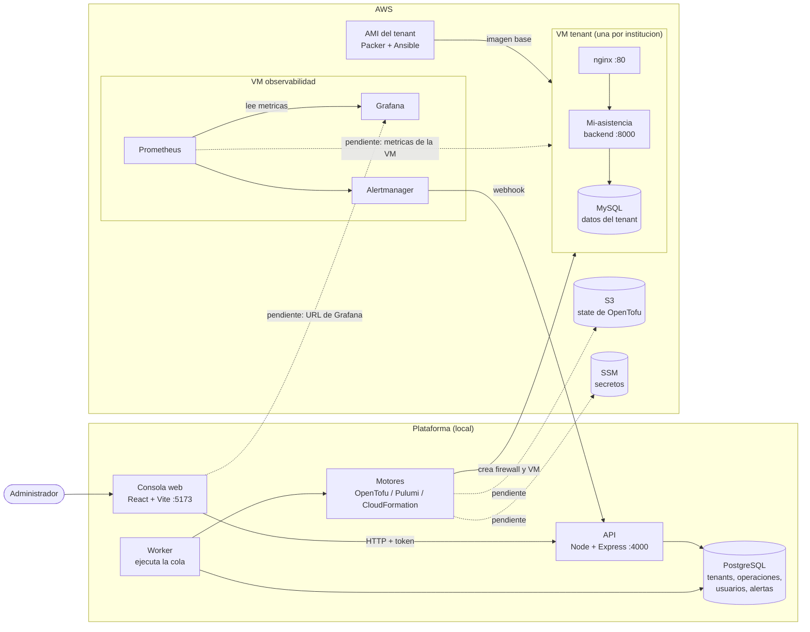
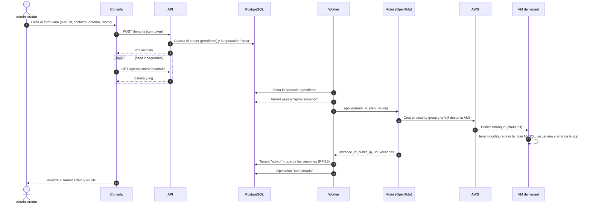
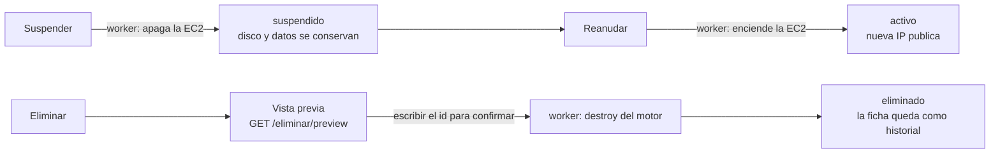

# Arquitectura de la plataforma

La plataforma crea y administra una VM en AWS por cada institucion (tenant). Cada VM tiene su propia app de asistencia (Mi-asistencia) y su propia base MySQL, asi ningun tenant comparte datos con otro.

La plataforma en si (consola, API, worker y su base PostgreSQL) corre en local. Los tenants y la observabilidad corren en AWS.

> En los diagramas, las lineas punteadas marcan lo que **aun esta pendiente** (ver la tabla al final).

## 1. Piezas y donde corre cada una

## 2. Que hace cada pieza

| Pieza | Que hace | Carpeta | Integrante |
|---|---|---|---|
| Consola web | Pantallas para el administrador: login, tenants, crear, detalle, planes, monitoreo | `web/` | 2 |
| API | Recibe los pedidos, valida la sesion y los permisos, y anota cada trabajo en la cola | `api/api.js`, `api/auth.js` | 1 |
| PostgreSQL | Base de la plataforma: planes, tenants, operaciones, despliegues, usuarios y alertas | `db/schema.sql` | 1 |
| Worker | Toma los trabajos pendientes y los ejecuta en segundo plano con el motor del tenant | `api/worker.js` | 1 |
| Motores | Crean y destruyen la infraestructura de un tenant. Todos cumplen el mismo contrato | `api/motor-*.js`, `contrato/` | 1 |
| Plantillas de infraestructura | Firewall y VM del tenant en OpenTofu, Pulumi y CloudFormation | `infra/` | 4 |
| AMI del tenant | Imagen con nginx, Node, MySQL y la app ya instalados | `packer/`, `ansible/` | 3 |
| Observabilidad | Prometheus, Grafana (tablero por tenant) y Alertmanager | `observabilidad/` | 5 |
| Seguridad y CI | 3 escaneres y pruebas de aislamiento en cada Pull Request | `.github/`, `tests/`, `security/` | 6 |

**Roles:** `admin_plataforma` ve y administra todos los tenants. `admin_tenant` solo ve y opera su propia institucion.

**Docker:** las VM de los tenants no usan Docker (Packer + Ansible). La VM de observabilidad si usa Docker Compose para levantar Prometheus, Grafana y Alertmanager juntos: es una unica VM de herramientas y asi se reutiliza la configuracion ya probada.

**Metricas de cada tenant:** `node_exporter` (9100), `mysqld_exporter` (9104) y un contador de la app (3000, entre nginx y el backend). El firewall solo abre esos puertos a la IP de Prometheus (`MONITORING_CIDR`).

## 3. Flujo: crear un tenant

Si un paso falla, la operacion queda `fallida` con su error y se puede **reintentar** (RF-12). OpenTofu guarda un state por tenant, asi el reintento no duplica recursos.

## 4. Flujo: suspender, reanudar y eliminar

## 5. Pendientes

| Pendiente | Que falta | Integrantes |
|---|---|---|
| Metricas de las VM | El codigo ya esta (rol `monitoreo` y `MONITORING_CIDR`). Falta construir la AMI nueva con Packer y probarlo con Prometheus en AWS | 3, 4 y 5 |
| Grafana en AWS | Desplegar la VM de observabilidad y conectar su URL a la consola (`VITE_GRAFANA_URL`) | 5 |
| Webhook de alertas | Alertmanager envia a `host.docker.internal:4000`, que solo funciona en la misma PC. Con Grafana en AWS debe apuntar a una direccion alcanzable de la API | 1 y 5 |
| State en S3 | Hoy esta en `api/workdir/<tenant_id>`. Moverlo a un bucket S3 cifrado y con bloqueo | 1 y 4 |
| Secretos en SSM | La clave inicial del admin del tenant viaja en `user_data` | 1 y 4 |
| Prueba en AWS real | Todo el flujo se probo con `ENGINE=fake` | Equipo |
